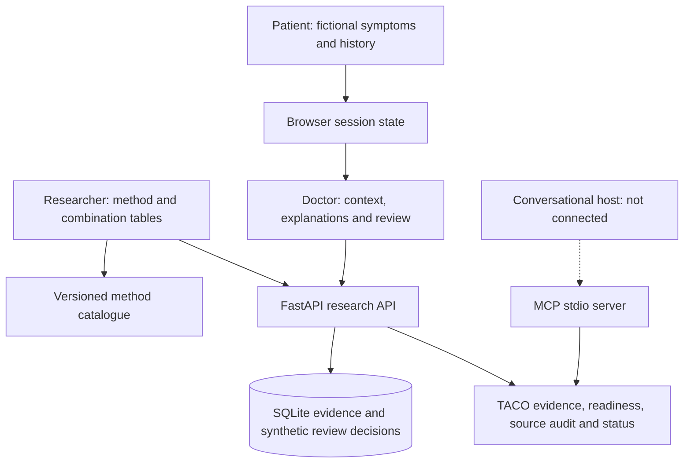
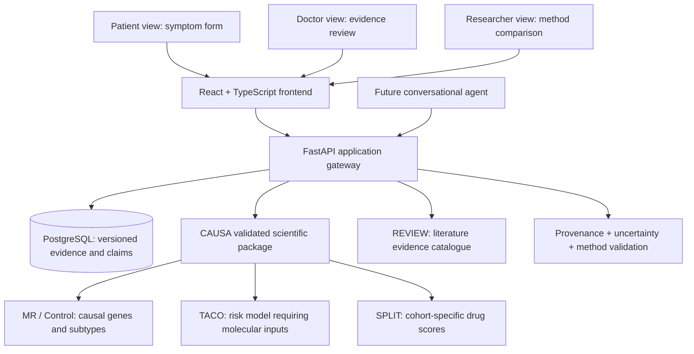

# CAUSEWAY Atlas v2: Current and Proposed Architecture

## Implemented in v2

The existing frontend uses plain HTML/CSS/JavaScript and FastAPI/SQLite. Patient history (symptoms, comorbidities and current medicines) stays only in browser memory and is shared with the Doctor view. The Doctor view explains the exact illustrative symptom-matching rule. Research method and pipeline metadata live in `static/research_catalogue.json`, read by the API and embedded in the generated offline demo.

The application and TACO tools share release version `2.0.0` from `taco_agent/__init__.py`. The website displays **v2**. `/api/health`, OpenAPI metadata and `/api/taco/status` expose the same release version.

`taco_agent/core.py` implements evidence, source-audit, status and manifest-readiness functions. FastAPI exposes these under `/api/taco/`; `taco_agent/server.py` exposes the same functions using MCP over stdio. An MCP host provides the LLM. The host connection and scientific prediction execution remain separate, pending steps. The manifest tool accepts descriptions, not measurement files or patient records.



## Future production architecture

The model below remains a future architecture, including React, PostgreSQL and validated scientific execution.



The diagram is a recommendation, not a finalised specification. Clinical symptom collection and patient-doctor data sharing require explicit consent, authorisation, security, data protection and ethics/governance approval, beyond this demonstration.

## Role matrix

| Portal | Implemented in v2 | Future capabilities | Hard boundary |
|---|---|---|---|
| Patient | Fictional symptoms, comorbidities and current medicines; browser-session sharing | Plain-language conversation, source-based education, potential symptom triage **only if validated** | No fabricated risk percent, subtype diagnosis, or medication advice |
| Doctor | Shared intake and history, exact symptom-rule explanations, evidence links and demo review decisions | Explain validated model output and record authorised clinical review | No model feature attribution without an executed model; secure accounts required for real cases |
| Researcher | Source catalogue, gene support, omics summary, ten method components, eight proposed/reference combinations and TACO evidence/readiness tools | Retrieve validated gene ranks and cohort drug outputs; execute reproduced pipelines through a conversational host | No invented numeric ranks, universal confidence, or phantom executed tools |

## Contract for future scientific tools (proposal)

```
GET /api/v2/evidence?entity_type=gene&entity_id=STAT3
GET /api/v2/genes/{gene_id}/compare-methods
GET /api/v2/cohorts/{cohort_id}/drug-rankings
POST /api/v2/predictions  # authorized, validated molecular-data pipeline only
POST /api/v2/agent/queries  # future read-only tool orchestration
```

Return structured evidence objects including `entity_id`, `method_id`, `dataset_id`, `cohort_id`, `statistical_measure_type`, `statistical_measure_value`, `uncertainty_type`, `uncertainty`, `source_id`, `commit_hash` and `validation_status`.

These versioned routes are proposals, not implemented endpoints. Current routes remain `/api/catalogue`, `/api/research-methods`, `/api/taco/*` and `/api/demo-reviews`, as documented in README.md.
