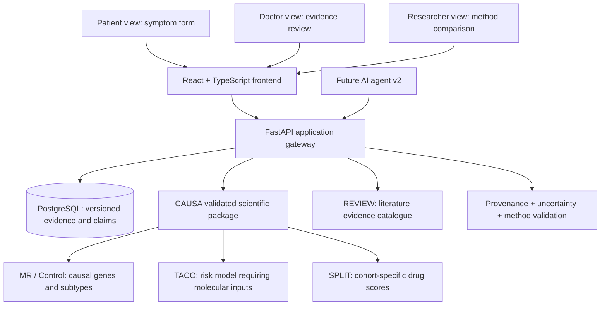

# CAUSEWAY Platform: Proposed Architecture (Draft)



The diagram is a recommendation, not a finalised specification. Clinical symptom collection and patient-doctor data sharing require explicit consent, authorisation, security, data protection and ethics/governance approval, beyond this demonstration.

## Role matrix

| Portal | Version 1 now | Planned agent capabilities (v2) | Hard boundary |
|---|---|---|---|
| Patient | Anonymous checkbox demo, approximate matching to published symptom themes, evidence explainer | Plain-language conversation, source-based education, potential symptom triage **only if validated** | No fabricated risk percent, subtype diagnosis, or medication advice |
| Doctor | Demo-only intake, linked evidence, agree/needs-review/disagree state | Compare model output with evidence, request alternate methods, provide human decision | No automated medical decision; require secure login for real cases |
| Researcher | Source catalogue, MR/CT/DCE support table, omics review table | Retrieve comparative gene ranks, explore cohort drug scores, invoke validated pipelines, summarise methods and limitations | No invented numeric ranks, universal confidence, or phantom executed tools |

## Contract for future scientific tools (proposal)

```
GET /api/v1/evidence?entity_type=gene&entity_id=STAT3
GET /api/v1/genes/{gene_id}/compare-methods
GET /api/v1/cohorts/{cohort_id}/drug-rankings
POST /api/v1/predictions  # authorized, validated molecular-data pipeline only
POST /api/v1/agent/queries  # future read-only tool orchestration
```

Return structured evidence objects including `entity_id`, `method_id`, `dataset_id`, `cohort_id`, `statistical_measure_type`, `statistical_measure_value`, `uncertainty_type`, `uncertainty`, `source_id`, `commit_hash` and `validation_status`.
