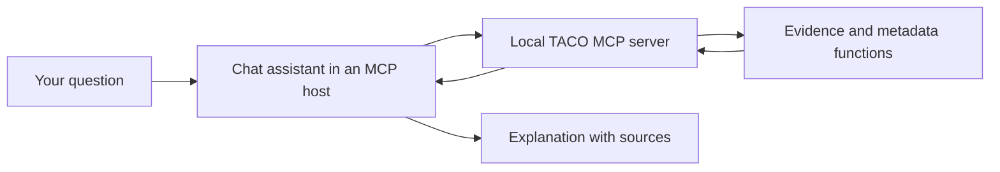

# CAUSEWAY Atlas v2, explained step by step

## 1. Understand the Paper2Agent reference

**Presentation skipped at your request.** The website source tree now contains the application, research tools, examples, tests and usage documentation. The current release is **v2**; its API and agent metadata report `2.0.0`.

A research paper describes a method. Its repository contains the code that implements it. To use that method, someone normally has to understand the code, install dependencies and prepare data.

The [Paper2Agent paper](https://arxiv.org/abs/2509.06917v2) provides the reference for connecting an assistant to research tools. Our TACO implementation applies that idea to the CAUSEWAY project; it is not a result reported by the Paper2Agent authors.

## 2. Build a first TACO agent

Three parts work together:



An **LLM** is the model that understands your question and writes a response. A **tool** is an ordinary function that does a defined task. **MCP** is the shared interface used to connect an assistant to those functions.

Four functions are implemented:

| Tool | What it does in plain language |
|---|---|
| `taco_evidence` | Returns curated information about purpose, inputs, evaluation and limitations, with source links |
| `assess_taco_readiness` | Checks a description of proposed data and lists missing requirements |
| `get_execution_status` | Reports which capabilities are available and which are missing |
| `inspect_reference_implementation` | Explains discrepancies found in the authors' current code and requirements |

These are functioning tools, not a functioning scientific prediction model. The browser buttons call the same functions through the local API. The browser does not contain an LLM. To talk to the tools in natural language, connect an MCP-compatible assistant using [the setup guide](TACO_AGENT.md).

The readiness example is **fictional metadata**: it says what kind of dataset you propose to use. A checklist can confirm that you supplied a gene identifier system or a split description. It cannot verify the data's quality, reproduce the paper, or calculate someone's risk.

Why prediction is still pending: the inspected README specifies TabPFN 2.0.9, while the prediction requirements specify 2.2.1. The notebook also labels an ensemble as TACO. We need an agreed reference, a compatible isolated environment, and matching reference outputs before adding execution. The file hashes and exact observations are recorded in the agent guide.

## 3. Add other conditions and medicines

**Comorbidity** means another health condition a person has. For example, a fictional Long COVID case might also list asthma.

In Patient Portal, choose **List conditions** and select or add a fictional condition. Choose **List current medicines** and enter a fictional medicine name. Dose, frequency and reason are optional; the interface displays **Not supplied** when a detail is missing. Use the remove button to correct an entry.

The form distinguishes three states:

| State | Meaning |
|---|---|
| Not supplied / unknown | We do not know the history |
| None | The fictional case explicitly reports none |
| Listed | Individual entries have been supplied, or are awaiting entry |

The doctor sees this history in the same browser session. Reloading clears it. There is no database table or browser persistent storage for these fields. Real patient data should not be entered into this existing unauthenticated prototype.

These fields supply review context. They do not become new TACO predictors automatically, and they do not check medicine interactions.

## 4. Compare methods in Researcher Portal

Each row describes what a method needs, what it produces, where it came from, and whether it is implemented locally. Filter by research task to reduce the number of rows.

| Task | Plain-language question |
|---|---|
| Causal discovery | Which genes have evidence suggesting a role in the disease or its network? |
| Subtyping | Are there molecular groups within the study population? |
| Early detection | Can a molecular model predict a later outcome in evaluated data? |
| Drug repurposing | Which existing drugs warrant further research, or deprioritisation, in a specified cohort? |

The table contains ten core components from the five linked project modules. It is not an exhaustive extraction of every algorithm mentioned in all 101 studies cited by REVIEW. The 11-gene table remains a separate SPLIT support subset, not the MR/CT paper's complete candidate list.

## 5. Explain the Doctor Portal display

Select **Brain fog**, **Memory / concentration issues** and **Sleep disturbances** in Patient Portal. In Doctor Portal, the explanation shows two matches for the neuro-psychological/dental interface rule and one for the respiratory–sleep rule.

The explanation gives the actual selected symptoms and the full matching rule. That lets you see why the theme appeared. The paper's molecular clusters and our checkbox display are different operations: the display is not a validated subtype assignment.

**Feature attribution** would describe how a fitted model used inputs for a particular prediction. It cannot be displayed honestly here because the prediction model has not run. There are no fabricated feature importance bars, SHAP values or risk percentages.

Changing the fictional intake resets a previous review choice so the reviewer must assess the new context.

## 6. Explore combinations

The combination table is an experiment planning aid. A row describes a possible sequence of methods, like ingredients and instructions for a research task.

Select two or more methods. Read the requirements in the preview, then click **Add to comparison**. The selection is added to the same table as the reference workflows and can be removed. Session selections are cleared on reload.

For example, selecting **ConC consensus clustering** and **PlaNet** produces a warning: a molecular subtype does not automatically define a clinical-trial cohort. Connecting them would need an explicit mapping and a separate evaluation.

A published workflow means that the linked source describes it. It does not mean CAUSEWAY has reproduced or executed it. Proposed combinations have no claimed accuracy, efficacy or combined confidence score.

The existing [Shiny application](https://sindypin.shinyapps.io/github/) can be opened using **Open Shiny explorer**. It remains an external resource, not a live result feed into CAUSEWAY.

## Run and rebuild

From the project directory:

```powershell
.\.venv\Scripts\python.exe -m uvicorn app:app --reload
```

Open `http://127.0.0.1:8000/`. The offline `CAUSEWAY_demo.html` works without a server for the forms, explanations and comparison tables. The evidence/readiness buttons need the server.

If you edit the portal sources, rebuild the standalone file:

```powershell
.\.venv\Scripts\python.exe scripts/build_demo.py
```

## Next research milestone

Resolve the TACO source/version questions with the authors and reproduce one agreed example. Successful completion means we can compare the same input and output with the reference and explain discrepancies. Only then should the agent expose a scientific prediction tool.
